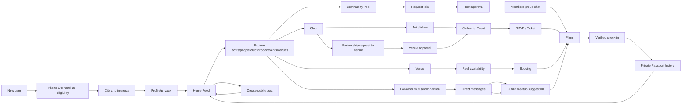

# END-TO-END USER JOURNEYS / STATE MACHINES

### Critical domain rules
1. Pool: any eligible account can create a non-ticketed casual activity. `capacity_total` counts the organizer. `available_slots = total - approved members`. Other accounts request; creator approves, declines or removes. Creator cannot approve self, blocked, expired, cancelled, already joined or duplicate request. Concurrency/transaction protects final spot. Member-only group chat and venue details. A failed join request must stay failed, never locally accepted.
2. Club: anyone can request/follow; only verified administrators can act for the club. Verified club means platform-approved identity/ownership plus **at least 4 unique active accounts whose phone number is verified**, each with active club membership. Club verified status is recomputed/checked at event creation/publication and meaningful administrative changes. Third member does not enable publishing; fourth does, contingent on platform approval.
3. Event: only authorized eligible club managers can create/publish official events, manage tickets/RSVP and invite venues. No user-created event, no impersonated official organizer. Club event may be free initially; paid tiers enabled only after verified payments launch.
4. Venue: owners claim/prove venue; availability is based on venue configured inventory and opening schedule (not arbitrary demo times). HOLD/REQUESTED/CONFIRMED/CANCELLED/EXPIRED/FAILED state transitions persisted server-side. Group/event-space booking may require owner approval. Payment/provider processing separate from booking intent.
5. Profile/Passport: attendance verified by server check-in; personal journaling is self-recorded; display distinct labels. Default hide exact history, location pins, sensitive times and club attendance until explicit consent.
6. Content: posts/comments/reactions/saves, follow and report/block. Content creation requires terms acceptance. Deleted/blocked/moderated content disappears from discovery with audit/admin records as appropriate.
7. Chat: direct chat only when consent or platform-defined mutual accepted connection permits; Pool/event chat only for approved members; leaving/removal revokes access. Message sends require real server ACK; failed sends are marked retryable.
8. Growth: events/pools/venues/posts use shareable deep links. Notifications are preference-driven, respectful, and not fake urgency.

### Example user stories
- **Solo user** posts a photo, follows an interesting person, saves an event and finds a café without joining a club.
- **Pool host** creates table tennis for total 4 people (host + 3), approves three requests, then locks the pool automatically when full. A fourth concurrent approval loses with proper conflict.
- **Prospective club** has three verified active members and cannot publish. After a fourth member joins and platform approval exists, organizer can publish an official event; loss of eligibility triggers documented handling for future events (do not silently erase confirmed tickets).
- **Club and café** agree terms and co-publish an official event. Club organizers manage attendees, café staff manage booking and offers, neither sees data outside authorized scope.
- **User attends event** with server check-in, sees optional private Passport entry, and can choose to post a recap without exact location.
